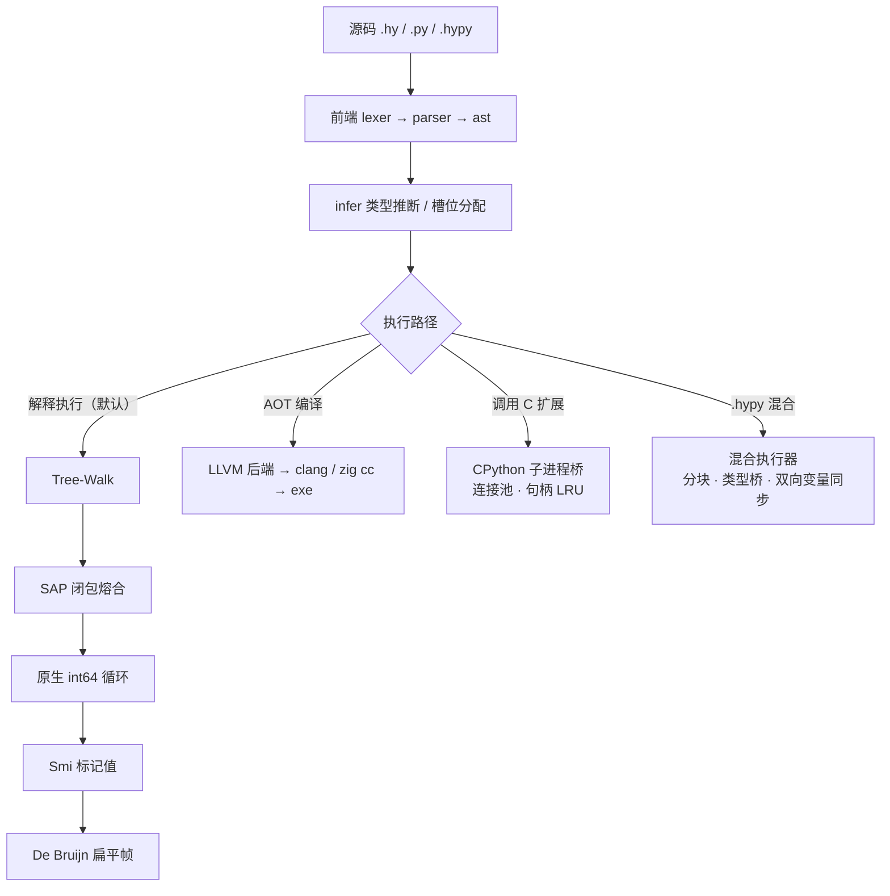

<div align="center">

# zuzo

**中文语法编程语言 · 纯 Go 实现 · 单二进制交付**

五层执行栈 · 内嵌 Python 运行时 · CPython 子进程桥 · `.hypy` 混合执行 · LLVM 后端

[](https://github.com/nimamasl114514/zuzo/actions/workflows/ci.yml)
[](https://go.dev/)
[](LICENSE)
[](#平台)

[特性](#特性) · [快速开始](#快速开始) · [语言样例](#语言样例) · [性能](#性能) · [架构](#架构) · [测试](#测试) · [文档](#文档)

</div>

> **English** — zuzo is a Chinese-syntax programming language implemented in pure Go. It ships a
> five-tier execution pipeline (tree-walking → SAP closures → native int64 loops → Smi-tagged values →
> De Bruijn flat frames), an embedded Python runtime (self-hosted parser + a gopapy dual-track front end),
> a CPython subprocess bridge with connection pooling, and a `.hypy` mixed-language executor that runs
> zuzo and Python blocks in one file with by-name variable sharing. A LLVM backend turns `.hy` straight
> into a native executable, and a bundled `zig cc` toolchain means no external compiler is required.
> On a 1,000,000-iteration integer loop (same machine, median): **zuzo 23.6 ms**, embedded Python 21.1 ms,
> CPython 3.12 165.3 ms.

## 特性

| 分类 | 能力 |
|---|---|
| **语言内核** | 中文关键字（`变量 / 函数 / 当 / 对于 / 如果 / 返回 / 打印`）、UTF-8 标识符、闭包、异常、`匹配`、推导式、`断言` 内置 |
| **五层执行栈** | Tree-Walk → SAP 闭包熔合 → 原生 int64 循环 → Smi 标记值 → De Bruijn 扁平帧；逐层回退、语义恒定 |
| **内嵌 Python** | 自研 Python 3.14 语法解析器 + [gopapy v2](https://github.com/tamnd/gopapy) 双轨前端；运行时**不依赖 CPython** |
| **CPython 子进程桥** | `导入 numpy` 后点号直调 `numpy.array([1,2,3]).sum()`；连接池 `ZUZO_PY_POOL=N`、句柄 LRU、`py取值(df, "records+index")` 保留 DataFrame 索引 |
| **混合语言 `.hypy`** | 单文件 `##ZUZO` / `##PY` 分块，两个运行时按名字双向同步变量 |
| **LLVM 后端** | `--emit-llvm` 出文本 IR、`--emit-exe` 出原生 exe；与解释器逐字节对拍 |
| **工具链** | `zpm` 包管理器（`doctor` / `build` / `build --release[=Oz]`）、自带 `zig cc`（`zuzo toolchain status\|install\|env`，支持本地目录或 URL 直下）、`--check` 类型检查、`--analyze` 拓扑分析、`--shadow` 影子模式 |
| **测试与可观测** | `zuzo test` 用例运行器、`GC统计()`（live / total / collections / objects）、`ZUZO_CPUPROFILE` CPU 采样 |
| **内置能力** | HTTP 服务端、浏览器自动化（chromedp）、CFFI / WASM FFI（wazero）、并发原语、正则、编码、集合库、`文本` 命名空间（110 成员） |

> **平台**：当前主要在 **Windows x64** 开发与验证（CFFI 加载路径与浏览器内置依赖 Windows API）；Linux/macOS 移植见 [开发状态](docs/dev-status.md)。

## 快速开始

```bash
# 构建（需要 Go >= 1.26）
go build -o zuzo ./

# 交互式 REPL
./zuzo

# 执行
./zuzo examples/hello.hy              # zuzo 源码
./zuzo tests_py/t01_hello.py          # Python 源码
./zuzo examples/mixed_demo.hypy       # 混合语言
./zuzo -e '打印("你好")'               # 内联

# 装 Python 库（与 py导入 共用同一个 CPython 解释器）
./zuzo pip install numpy pandas
./zuzo pip list

# 类型检查 / 拓扑分析 / 测试
./zuzo --check 文件.hy
./zuzo --analyze 文件.hy
./zuzo test examples/tests

# LLVM 后端：生成 LLVM IR / 生成 exe
./zuzo --emit-llvm 文件.hy         # 产出 文件.ll（文本 IR）
./zuzo --emit-exe 文件.hy          # 产出 文件.exe（clang 优先，缺失时自动用自带 zig cc）
./zuzo toolchain status            # 看当前编译器（zig / clang）与路径
./zpm doctor                       # 包管理器体检（工具链 + zuzo + Python 桥）
```

> 本机 gcc 不在 PATH 时用 zig 的 clang 顶替：
> `CGO_ENABLED=1 CC="/c/Dev/zig/zig cc" go build -o zuzo.exe ./`

## 语言样例

```zuzo
函数 斐波那契(n) {
    如果 n <= 1 { 返回 n }
    返回 斐波那契(n - 1) + 斐波那契(n - 2)
}

变量 总 = 0
对于 i 在 范围(10) {
    总 = 总 + 斐波那契(i)
}
断言(总 == 88, "累加结果不对")
打印("前 10 项和 =", 总)
```

```python
##PY
总 = 0
i = 0
while i < 1000000:
    总 += i
    i += 1
print(总)
```

## 性能

同一台机器（i7-14650HX / Windows / Go 1.27.1），1,000,000 次整数累加，中位数：

| 场景 | 耗时 | 每次迭代 |
|---|---|---|
| zuzo SAP（原生循环） | 23.6 ms | 23.6 ns |
| zuzo 块（混合模式） | 23.7 ms | 23.7 ns |
| **内嵌 Python（原生循环）** | **21.1 ms** | **21.1 ns** |
| CPython 3.12 | 165.3 ms | 165.3 ns |
| zuzo Tree-Walk（`--no-sap`） | 254.9 ms | 254.9 ns |
| 启动（`-e` 空跑） | 18.8 ms | — |
| 跨语言调用（zuzo→py） | 1.10 µs/次 | — |

复现：`python bench/mix/bench_mix.py`；CPU 采样：`ZUZO_CPUPROFILE=/tmp/cpu.prof ./zuzo 目标.hy`。

## 架构



**五层不是五个模式，而是一条回退链**：同一段语义在每层都必须等价，任何一层不支持就自动回退到下一层（`--shadow` 影子模式正是用 Tree-Walk 做双轨对拍来守住这条底线）。

## 目录结构

| 目录 | 说明 |
|---|---|
| `lexer/ parser/ ast/ token/` | zuzo 语言前端 |
| `infer/` | 类型推断与槽位分配 |
| `evaluator/` | 求值器 + SAP 编译（`sap*.go`）+ 内置函数 |
| `object/` | 值表示（Smi 标记、Context 扁平帧、arena） |
| `py/` | 内嵌 Python：`parser/ runtime/ object/ pyparse/`（gopapy 适配） |
| `mix/` | 混合语言执行器（切块 / 类型桥 / 调用桥 / 块级 SAP） |
| `llvmbackend/` | LLVM 后端：AST → LLVM IR → clang → exe（含 C 运行时库） |
| `pyext/` | CPython 子进程桥（连接池 · 句柄协议 · child.py） |
| `toolchain/` | 自带 zig 工具链（探测 / 安装 / 校验） |
| `zpm/ cmd/zpm/` | 包管理器 |
| `bench/` | 跨语言基准（C/Go/Java/JS/Python/Rust/zuzo） |
| `tests/ tests_py/ tests_mix/ tests_bridge/` | Go 单测 / Python 对拍 / 混合 golden / 桥用例 |
| `docs/` | 语言、混合、Python、性能、CFFI、WASM、工具链文档 |

## 测试

```bash
./run_tests.sh             # Python 语义与 CPython 逐字节对拍（33 用例 + --shadow 双轨）
./run_tests_mix.sh         # 混合语言 golden（15 用例）
./run_tests_llvm.sh        # LLVM 后端对拍（20 用例）
./run_tests_bridge.sh      # CPython 子进程桥对拍（19 用例）
./run_tests_toolchain.sh   # 自带工具链（6 项）
go test ./...              # Go 单测（9 包）
```

当前状态（2026-11-07 实测）：`run_tests` **33/33**；`run_tests_mix` **15/15**；`run_tests_llvm` **20/20**；`run_tests_bridge` **19/19**；`run_tests_toolchain` **6/6**；`projects/mini_scheme` 解释器与 LLVM 产物均 **31/31**；Go 单测 **9 包全绿**（`ast` / `diagnostic` / `evaluator` / `fuzz` / `infer` / `llvmbackend` / `mix` / `pyext` / `tests`）。详细矩阵见 [开发状态](docs/dev-status.md)。

## 文档

| 主题 | 文档 |
|---|---|
| 语言 | [语言概览](docs/language-overview.md) · [语言规范](docs/language-spec.md) · [字符串标准库](docs/string-library.md) |
| 执行与互操作 | [混合语言](docs/mixed-language.md) · [Python 支持](docs/python-support.md) · [Python 前端](docs/python-parser.md) · [CPython 子进程桥](docs/python-bridge.md) · [跨语言互操作](docs/interop.md) |
| 编译与工具链 | [LLVM 后端](docs/llvm-backend.md) · [自带工具链（zig cc）](docs/toolchain.md) · [能力矩阵](docs/capability-matrix.md) |
| 运行时 | [性能模型与观测](docs/performance.md) · [内存回收](docs/gc.md) · [CFFI](docs/cffi.md) · [WASM FFI](docs/wasm-ffi.md) |
| 项目 | [开发状态](docs/dev-status.md) · [能力矩阵](docs/capability-matrix.md) · [提交历史](https://github.com/nimamasl114514/zuzo/commits/main) |

## 许可证

[MIT](LICENSE)
